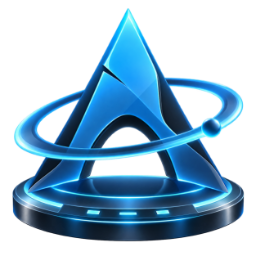

# Arch Dock

<p align="center">
  
</p>

Arch Dock is a dock and panel system for **Arch Linux with KDE Plasma 6 on
Wayland**. It gives you panels of three kinds, all designed in one place
(Panel Studio) and drawn by one renderer:

- **Bars** on a screen edge, Arch Dock's own windows that stand side by side
  on the same edge and hold Plasma's widgets (clock, launcher, system tray,
  spacers…) next to the dock's icons.
- **Edge panels** held by Plasma, where you want Plasma to own the panel.
- **Free panels** anywhere on the desktop: rings, arcs, circles, grids, a
  Möbius strip; turned and scaled as you like, flat or in real 3D.

Version **0.1.1** (release 47). Original Arch Dock work is licensed
**GPL-3.0-or-later** ([LICENSE](LICENSE)); the few MIT components keep MIT.

## Install

On Arch Linux with KDE Plasma 6, one command installs the newest package;
pacman fetches what it needs from the Arch repositories:

```bash
sudo pacman -U https://github.com/aivars11232/Arch-Dock/releases/download/v0.1.1-47/arch-dock-0.1.1-47-x86_64.pkg.tar.zst
systemctl --user restart plasma-plasmashell.service
```

Then open **Arch Dock** from the application menu: Panel Studio appears,
and a panel is a few clicks away. To update, run the same two lines with
the newer package from the [releases page](https://github.com/aivars11232/Arch-Dock/releases).
Building the package yourself, starting and stopping, recovery and
uninstalling are in [the installation guide](docs/INSTALL.md).

## What it does

**Looks.** Nineteen looks for a panel (glass, crystal, neon, aurora,
metallic, organic, river, magma, picture…), with 243 real texture pictures
for the material looks (CC0 photographs of real materials, not drawn noise), glow with its own reach
and intensity, your own picture as "panelpaper", and relief. **261 panel
decorations** in families such as gems, stone, precious metals, nature,
magic, alien, sci-fi, starships and energy, every one recolourable (main
and light colours, palettes, picture hue and strength, metal). Sixteen
built-in themes, 15 panel presets and 15 icon presets; your own presets and
profiles save whole arrangements.

**3D.** Panels drawn as real 3D (Qt Quick 3D) with free turning and
scaling, materials and bending; the dock's icons as solids modelled from
each icon's own picture (rings become tori, round icons globes, others
bevelled prisms), with their own lighting; glass bubble tiles; stands and
pedestals; holograms; icons mirrored in water on the river look. Icons
always face you.

**Icons.** Six icon styles, six shapes, tiles with thirteen textures,
per-icon properties (your own picture and label), running and attention
markers, badges and progress, window previews, and folder icons whose
contents open as a fan, arc, ring, stack, grid or Möbius strip along the
dock, sorted and sized as you choose (Icons in the folder's menu), with
previews.

**Bars.** Enter Edit Mode from a bar's right-click menu: Panel Studio
opens for that bar and every widget shows its remove and settings buttons.
Drag widgets, icons and whole groups of icons anywhere along the bar; a
**+** beside the bar adds a Spacer, a Margins Separator or any Plasma
widget. A bar fits its content or takes the length you set; thicker bars
grow their icons.

**Panel Studio.** One window per panel: General, Size, Appearance,
Behavior, Segments, Presets, Animations, Hologram, Widgets and 3D pages for
the panel; Icons, Icon Tiles and Pedestals; Profiles; and seven UI themes
for the Studio itself. Changes show on the desktop at once; Apply or OK
keeps them, Cancel drops them.

## Everyday use

- **Panels:** right-click an Arch Dock panel for **Configure Arch Dock…**,
  **Enter Edit Mode** (bars) and **Remove Panel**. New panels come from
  Panel Studio opened on its own, which starts on its new-panel page.
- **Icons:** drag an icon along its panel to a new place, in edit mode or
  not; a click still opens the application. Right-click for its menu.
- **Widgets on bars:** drag them anywhere along the bar; in edit mode use
  the ✕ and ⚙ beside each one, and the **+** outside the bar to add more.
- **Stopping:** right-click the Arch Dock entry in the application menu and
  choose **Quit Arch Dock**, or run `arch-dock --quit`. It stays stopped
  until you start it again or log in again.

## Requirements

Arch Linux, KDE Plasma 6.8 or newer, Wayland, Qt 6.11 or newer, KDE
Frameworks 6 or newer. True 3D needs Qt Quick 3D and a working GPU driver; without
them panels fall back to flat drawing. See
[known limitations](docs/KNOWN_LIMITATIONS.md).

## Building and contributing

The project uses CMake, Qt 6, KDE Frameworks 6 and CTest; build with few
jobs (`-j4` at most on 16 GB) and run tests one at a time. The sources:

- `src/` — the service (`arch-dock`), the bar program (`arch-dock-bars`),
  the settings schema and the panel model;
- `qml/ArchDock/Rendering/` — the shared renderer (layouts, looks, 3D,
  folder openings, decorations, materials);
- `plasma-dock-widget/`, `plasma-bar-containment/`, `plasma-bar-shell/` —
  the Plasma widget, the bar containment and its shell;
- `qml/runtime/` — Panel Studio; `data/` — themes, presets, icon styles;
- `tests/` — unit tests, QML tests and private-session smoke tests.

Code comments explain the why in plain words; please keep them that way.
[The installation guide](docs/INSTALL.md) describes a fresh build and a
disposable staging install; [the lifecycle guide](docs/plasma-lifecycle.md)
describes the private Wayland sessions the tests use, so nothing touches
your own desktop.

## Documentation

- [Installation guide](docs/INSTALL.md) — package, start and stop, bars,
  upgrades, recovery, uninstall.
- [Known limitations](docs/KNOWN_LIMITATIONS.md) — platform boundaries.
- [Changelog](CHANGELOG.md) — what each release changed.
- [Preset packages](docs/PRESET_PACKAGE.md), [theme packages](docs/THEME_PACKAGE_V2.md),
  [profiles](docs/PROFILE_PACKAGE.md), [icon style packages](docs/ICON_STYLE_PACKAGE.md)
  — the file formats.
- [Current state](docs/CURRENT_STATE.md) and the [repair reports](docs/repairs/)
  — the project's own working notes and test evidence.
- [Licensing matrix](packaging/LICENSING.md) — the GPL-3.0-or-later default
  and the preserved MIT components.
